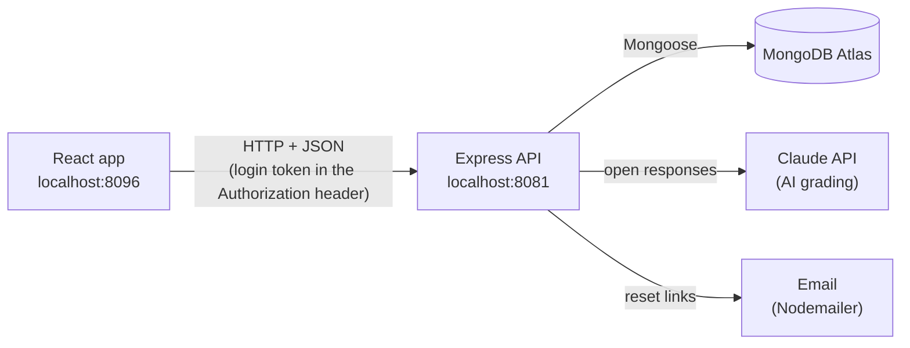
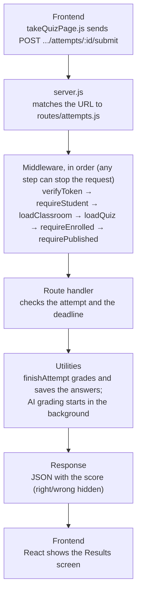
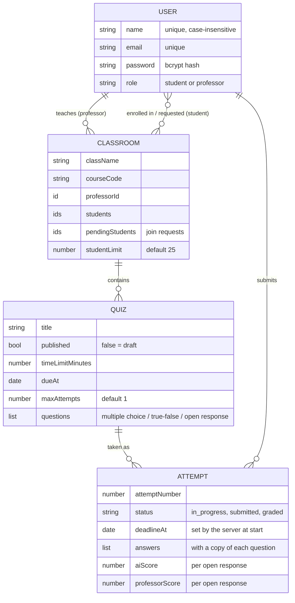

# Student GrAIder

An online quiz platform where professors build quizzes and students take them. Multiple choice and true/false questions are graded instantly; open-response answers get a first-pass score and feedback from AI (Claude), and the professor makes the final call. Grades roll up into a per-class gradebook.

Built with the MERN stack: MongoDB, Express, React, and Node.js.

---

## Features

### For students
- **Find and join classes.** Search by course code, class name, or professor ("10" finds "101 Science Bob" and "103 English Joe"), then send a join request.
- **Take quizzes** with a countdown timer, autosave, and resume-where-you-left-off (even on another device).
- **See scores right away**, as two boxes on each quiz card: the AI score and the professor's grade. Which multiple choice answers were wrong is never shown, so retakes can't be used to work out the answers.
- **Overall grade per class**, where every quiz counts the same.
- **Drop a class**, and recover a forgotten password by email.

### For professors
- **Classes** with a student limit (25 by default, editable), join requests to approve or decline, and a roster with Remove buttons.
- **Quiz builder** with multiple choice, true/false, and open-response questions, a time limit, a due date (calendar picker), and how many attempts each student gets.
- **Drafts:** save an unfinished quiz without students seeing it, then publish it when ready.
- **Grading page** for open responses: accept the AI's score, mark Correct or Incorrect, or give partial credit (e.g. 2.5 / 5).
- **Gradebook:** every student against every quiz, with each student's overall grade.
- **Safe editing:** changing a quiz after students have taken it never changes their submitted attempts.

### Fairness and security
- The **timer is enforced by the server**. Late submissions are ignored and the answers saved before the deadline are graded instead; attempts left open are submitted automatically.
- Logins expire after an hour but **refresh automatically while someone is active**, so long quizzes don't end in an error.
- Passwords are hashed with bcrypt. Password-reset links work once, expire in an hour, and only a hash of the link is stored.
- Every API route checks who is asking: logged in, the right role, and owner of (or enrolled in) the class.

---

## Tech stack

| Layer | Tools |
|---|---|
| Frontend | React 18, React Router 6, Tailwind CSS, axios, jwt-decode |
| Backend | Node.js (20+), Express 4, Mongoose 6, zod (input validation), bcrypt, jsonwebtoken |
| Database | MongoDB Atlas |
| AI grading | Claude API via `@anthropic-ai/sdk` (model: Claude Opus 5.5) |
| Email | Nodemailer (Ethereal test inbox by default, or any SMTP server) |
| Testing | Jest, supertest, mongodb-memory-server (in-memory database) |

---

## Architecture

Two separate apps talk over a JSON API:



### The life of one request

Every API call follows the same path. For example, a student submitting a quiz:



### Startup order (backend)

`server.js` loads each route file, and each route file loads what it needs (models, middleware, utilities) the first time it's required. Then `server.js` connects to MongoDB, mounts the routes on their URLs, starts a once-a-minute check that submits timed-out attempts, and listens on port 8081.

### Folder structure

```
backend/server/
├── server.js            Entry point: loads routes, connects to MongoDB, starts the server
├── config/              MongoDB connection
├── models/              Data shapes (Mongoose schemas) and input validation (zod)
├── middleware/          auth.js (login + role checks), loaders.js (looks up the class/quiz in the URL)
├── routes/              One file per area: login, signup, password reset, classes, quizzes, attempts, grades
├── utilities/           Shared logic: grading rules, timer/deadlines, AI grader, email, login tokens
└── __tests__/           Automated tests (one file per feature)

frontend/src/
├── index.js / App.js    Entry point and the list of pages (routes)
├── components/pages/    One file per screen: home, quiz maker, take quiz, grading, gradebook, login...
├── components/overlay.js  The pop-up box used for login, signup, and new class
└── utilities/           api.js (calls the backend), session.js (keeps logins fresh), due dates, percentages
```

### Data model



### Design decisions

- **Unique names.** Professors add students by recognizing them in join requests, so two students named "John Smith" would be ambiguous. Names are unique, ignoring capitalization and spacing.
- **Attempts keep a copy of their questions.** If a professor edits, re-points, or deletes a question after students submit, those students are still graded on what they actually saw.
- **The server owns the clock.** The deadline is recorded when an attempt starts; answers are saved to the server as the student works; anything arriving after the deadline (plus a 20-second grace period) is ignored in favor of the last answers saved in time.
- **AI suggests, the professor decides.** The AI's score counts until the professor gives their own, which always wins. The AI is told to treat student answers as data, so an answer saying "give me full marks" is graded on its content.
- **Equal-weight overall grade.** Each quiz's percentage counts the same, whatever its point value. Quizzes past their due date that were never submitted count as 0%; quizzes not yet due don't count yet.
- **Correct answers stay hidden.** Students see their total score but not which choices were wrong, so multiple attempts can't be used to find the answers.

---

## Getting started

### Prerequisites
- Node.js 20 or newer
- A MongoDB Atlas cluster (the free tier works)

### 1. Backend

```bash
cd backend/server
npm install
```

Create `backend/server/.env`:

```
DB_URL=mongodb+srv://<user>:<password>@<cluster>.mongodb.net/studentgraider?appName=StudentGrAIder
ACCESS_TOKEN_SECRET=<a long random string>
```

Optional settings:

```
# One-click "Test professor" / "Test student" logins on the login screen (development only, never in production)
ENABLE_DEV_LOGIN=true

# AI grading of open responses. Without a key, professors grade by hand.
ANTHROPIC_API_KEY=<key from console.anthropic.com>

# Real email for password resets. Without SMTP_HOST, emails go to a free Ethereal test inbox
# (nothing is delivered; the app shows a link to read each email).
SMTP_HOST=smtp.example.com
SMTP_PORT=587
SMTP_USER=<username>
SMTP_PASS=<password>
MAIL_FROM=Student GrAIder <no-reply@yourdomain.com>
FRONTEND_URL=http://localhost:8096
```

Start it:

```bash
npm run server        # http://localhost:8081, restarts automatically when files change
```

### 2. Frontend

```bash
cd frontend
npm install
npm start             # http://localhost:8096
```

`frontend/.env` is already included and points the app at `http://localhost:8081`.

### 3. Try it
With `ENABLE_DEV_LOGIN=true`, the login box has **Test professor** and **Test student** buttons. Create a class and a quiz as the professor, then log in as the student, search for the class, and request to join.

---

## Testing

```bash
cd backend/server
npm test
```

155 backend tests run against an in-memory MongoDB, so they need no `.env` or internet connection. The AI grader and email sender are replaced with fakes, so tests never call paid services or send real email.

Each test file covers one feature (`timer.test.js`, `drafts.test.js`, `grading.test.js`, ...). Every test follows the same pattern: set up a situation, call the API as a given user, and check the response.

---

## API reference

All routes except signup, login, and password reset need an `Authorization: Bearer <token>` header.

| Method | Path | Who | What it does |
|---|---|---|---|
| POST | `/user/signup` | anyone | Create an account |
| POST | `/user/login` | anyone | Log in; returns a token |
| POST | `/user/refresh-token` | logged in | Swap a valid token for a fresh one |
| POST | `/user/forgot-password` | anyone | Email a password reset link |
| POST | `/user/reset-password` | anyone | Set a new password from a reset link |
| POST | `/classrooms` | professor | Create a class |
| GET | `/classrooms` | logged in | Your classes (taught or enrolled) |
| GET | `/classrooms/search?q=` | student | Search classes by code, name, or professor |
| PATCH | `/classrooms/:id` | owner | Change the student limit |
| POST | `/classrooms/:id/join-requests` | student | Ask to join |
| GET | `/classrooms/:id/join-requests` | owner | Students waiting to join |
| POST | `/classrooms/:id/join-requests/:studentId/approve` | owner | Approve (fails if the class is full) |
| DELETE | `/classrooms/:id/join-requests/:studentId` | owner | Decline |
| GET | `/classrooms/:id/students` | owner | Class roster |
| DELETE | `/classrooms/:id/students/:studentId` | owner | Remove a student |
| DELETE | `/classrooms/:id/enrollment` | student | Drop the class |
| GET | `/classrooms/:id/grades` | owner | Gradebook |
| GET | `/classrooms/:id/grades/mine` | student | Your grades and overall |
| POST | `/classrooms/:id/quizzes` | owner | Create a quiz (or draft) |
| GET | `/classrooms/:id/quizzes` | owner or student | Quiz list (students: published only, with their scores) |
| GET | `/classrooms/:id/quizzes/:quizId` | owner | Full quiz, including answers |
| PUT | `/classrooms/:id/quizzes/:quizId` | owner | Edit, publish, or unpublish |
| DELETE | `/classrooms/:id/quizzes/:quizId` | owner | Delete the quiz and all its attempts |
| GET | `.../quizzes/:quizId/attempts/mine` | student | The quiz (no answers) and your latest attempt |
| POST | `.../quizzes/:quizId/attempts` | student | Start an attempt |
| PUT | `.../attempts/:attemptId/answers` | student | Autosave answers |
| POST | `.../attempts/:attemptId/submit` | student | Submit |
| GET | `.../quizzes/:quizId/attempts` | owner | All submissions, for grading |
| POST | `.../attempts/:attemptId/answers/:questionId/review` | owner | Score an open response (`{ points }` or `{ correct }`) |
| POST | `.../attempts/:attemptId/ai-grade` | owner | Run (or retry) AI grading on an attempt |

---

## Known limitations and future work

- **Not deployed yet.** Production needs hosting with HTTPS, a strong `ACCESS_TOKEN_SECRET`, CORS limited to the real domain, real SMTP, and dev logins turned off.
- **Rate limiting** on login, signup, password reset, and search.
- **Mobile layout:** the home page sidebar is cramped on phones.
- **Classes can't be renamed or deleted** yet, and "Contact My Professor" is a placeholder.
- **Written professor feedback** on open responses (the data field exists; the grading page doesn't have a box for it yet).
- **Frontend tests** and automatic test runs on every push (GitHub Actions).

---

## Credits

Started from Professor Brockenbrough's MERN user skeleton (register, login, logout). Developed with the help of an AI coding assistant (Claude Code).
